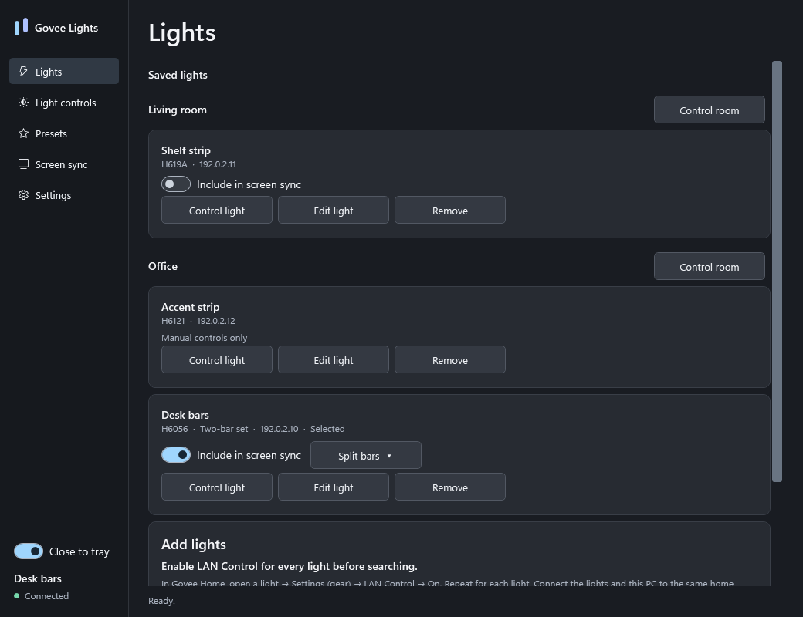
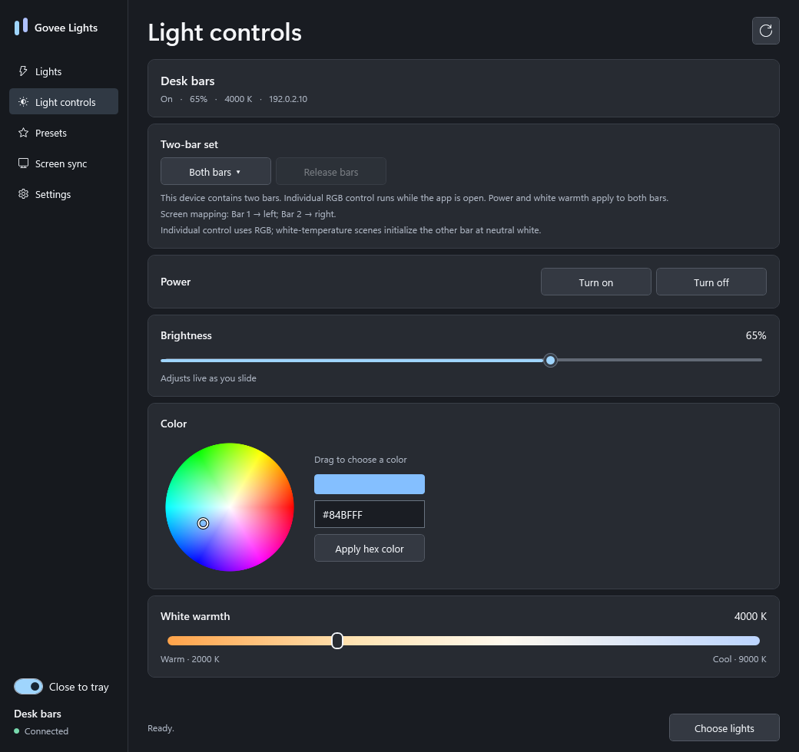
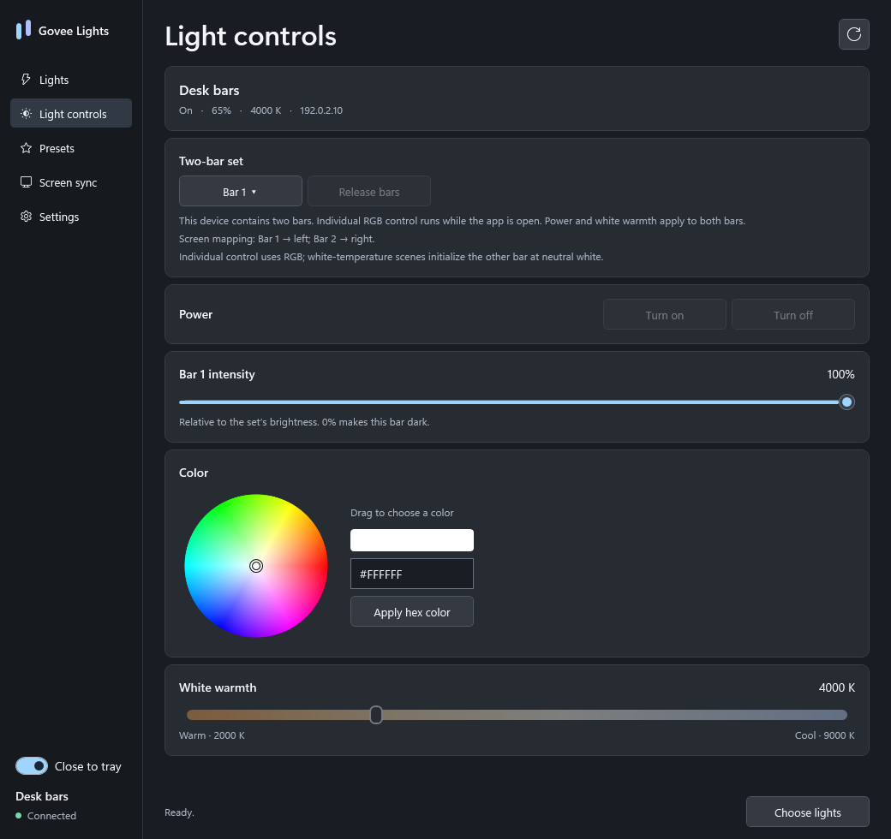
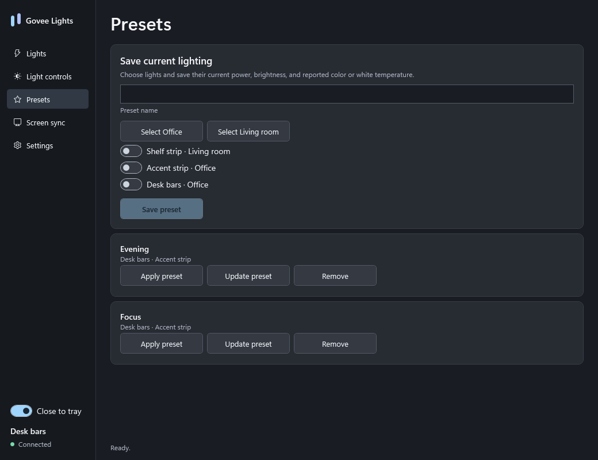
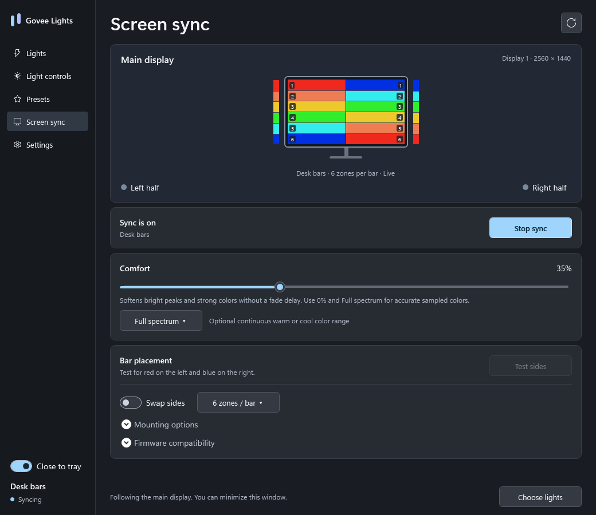
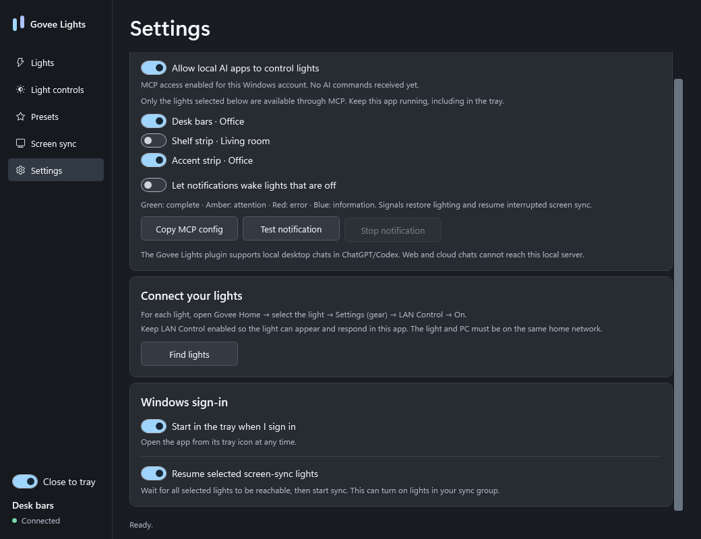
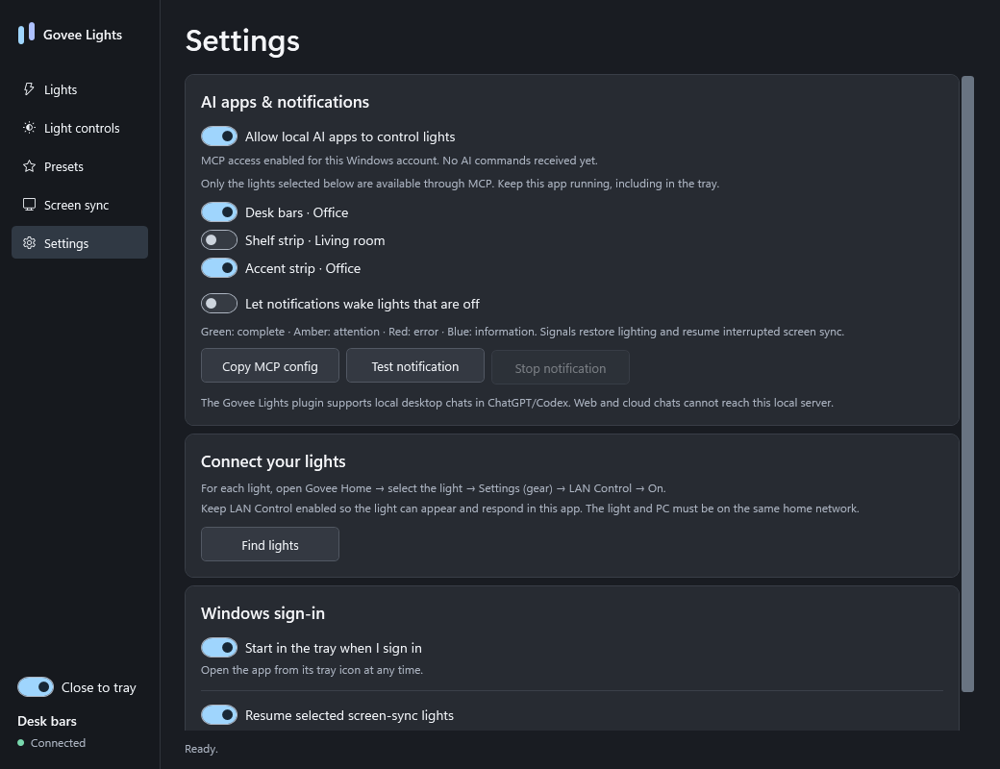

# Govee Lights

Manage compatible Govee lights on Windows 11. Organize rooms, save lighting presets, sync selected lights to the screen, and receive optional AI task notifications over the local network.

[Download the latest Windows release](https://github.com/midnitefox/govee-lights/releases/latest)



## Get started

1. Download the Windows x64 ZIP from Releases and extract it into a permanent folder.
2. Keep the extracted files together, then open `Govee Lights.exe`.
3. In **Govee Home**, open **each light → Settings (gear) → LAN Control → On**.
4. Connect the PC and lights to the same local network.
5. Open **Lights → Find lights** and add the devices you want.

**LAN Control must remain enabled for each light to appear and respond in this app.** The light’s model and firmware must offer that setting.

Windows 11 x64 and its included .NET Framework 4.8 runtime are the supported desktop environment. The release is an unsigned portable build.

## Everyday lighting

- **Rooms** organize lamps, strips, bulbs, bars, and other supported Govee lighting devices.
- **Light controls** apply power, brightness, color, or white temperature to one light or a room. Controls follow the capabilities reported by the device.
- **Live controls** include a radial color wheel, a warm-to-cool white slider, and brightness that changes as you drag.
- **Presets** capture the current reported settings of selected lights. Apply them later, update them from the lights, or remove them.
- **Screen sync** is opt-in for each saved light. Assign the whole display, left, right, top, or bottom as its color source.
- **Tray mode** keeps sync running when the window is closed. The tray menu opens the app, stops sync, opens presets, and quits.

New lights start in independent manual-control mode. Lights outside the active sync group remain available for manual control and presets.

### Multiple lights and status messages

Each saved device or set has its own card, name, room, and controls. Different models can share a room and a sync group. **Control light** selects one device; **Control room** targets the saved devices in that room. **Include in screen sync** independently chooses the sync group, so selecting a light for manual controls does not add it to sync.

| Area | Meaning |
| --- | --- |
| Saved-light card | Identifies one device or set. Its address or Offline label reflects the latest discovery result. Selected marks the currently focused device. |
| Sidebar light name | Names the currently selected device, even when other lights are also saved or syncing. |
| Sidebar status dot and text | Reports recent connection or operation state. Connected follows successful device communication; Syncing describes the active sync session. It is not a continuously verified connection count for all saved lights. |
| Bottom message, such as Ready | Describes the latest app operation, its result, or an error. It is separate from the selected-device label. |

For example, a bar set can sample two sides of the screen while a compatible lamp uses the whole display and a strip uses its top region. Each light keeps its own assignment. Models without streaming support remain available for manual controls and presets. The Screen sync page lists the group and allows switching the preview between devices.



Color and white warmth changes preserve the device's brightness setting. Available controls and white-temperature limits depend on the light's model and firmware.

### Individual lights in a set

Compatible sets offer a selector for the whole set or an individual member. Adjust a member's RGB color and relative intensity while keeping the set's overall brightness. Individual control continues while the app runs in the tray; **Release bars** returns the set to its previous lighting.

Member controls are available only for the models listed in the [compatibility guide](docs/COMPATIBILITY.md#individual-members-and-sampling-zones). Power and white warmth remain shared across the set. Release individual controls before saving a preset.





## Screen sync

Choose which lights follow the Windows primary display, then assign each light the whole display or a region: left, right, top, or bottom. These assignments describe the source of the color, so lights can be placed anywhere in a room.

- **Sampling zones** divide supported segmented sets into smaller screen regions. The preview shows the selected layout and segment mapping. Available zone counts depend on the [model and hardware layout](docs/COMPATIBILITY.md#individual-members-and-sampling-zones).
- **Comfort** softens bright peaks and highly saturated colors. Its default is 35%; use 0% with **Full spectrum** to retain the sampled colors.
- **Warm range** and **Cool range** keep colors within a narrower hue range while preserving neutral colors.
- **Responsive updates** prioritize the newest frame, with up to 60 captures and 30 color updates per second. Comfort processes each frame without adding a fade queue.
- **Stable sampling** suppresses small color fluctuations and brief changes in detected black borders.

Comfort preserves the device's stored brightness setting. Real flashes and scene cuts can still change the lighting immediately. Response time depends on the display, local network, and light firmware.



Lights without individual segment mapping use a single color from their assigned screen region. See [screen-sync processing](docs/SCREEN-SYNC.md) for algorithm details, capture recovery, and update limits.

## Start in the tray with Windows

Open **Settings** and enable the options you want.

- **Start in the tray when I sign in** registers the current executable for your Windows account.
- **Resume selected screen-sync lights** waits for the selected lights to become reachable, then starts the saved group. This can turn on lights in that group.

The tray menu can cancel a pending automatic resume. **Close to tray** separately controls the behavior of the window’s X button.



## AI apps and task notifications

In **Settings → AI apps & notifications**, enable local AI access and select the lights AI apps may control. **Copy MCP config** provides the stdio connection for other local Windows AI clients. The app and AI client must run under the same Windows account, with the app open or in the tray.



The included **Govee Lights MCP.exe** exposes nine tools: app status, permitted lights, live light state, persistent light controls, preset listing/application, screen-sync start/stop, temporary notifications, and notification cancellation.

| Signal | Color | Use |
| --- | --- | --- |
| Complete | Green | Requested work finished |
| Attention | Amber | Input, approval or another user action needed |
| Error | Red | A blocking failure |
| Information | Blue | A requested test or neutral update |

Signals make two gentle brightness pulses over about three seconds. The app restores reported power, brightness and static color afterward, and resumes an interrupted sync group. Lights that are off stay off unless **Let notifications wake lights that are off** is enabled. A canceled signal also restores lighting. Presets and signals cannot recover proprietary animated/DIY state that Govee does not report through LAN status.

### ChatGPT / Codex plugin

Download the separate **OpenAI plugin ZIP** from Releases, or install from this repository's marketplace using the Codex CLI:

```powershell
codex plugin marketplace add midnitefox/govee-lights
codex plugin add govee-lights@midnitefox-govee
```

Reload the desktop app if needed and select **Govee Lights** in a new local desktop chat. Try: **“Use Govee Lights to signal when this task finishes or needs my attention.”**

The plugin bundles the MCP executable and setup/notification skills, with no Node.js, Python, or OpenAI API key required. Notifications are sent by the assistant during the task where you requested them. Installing the plugin does not monitor all other chats or silently install lifecycle hooks.

This is a manually distributed Windows desktop plugin, following [OpenAI's local MCP packaging format](https://developers.openai.com/plugins/deploy/desktop-only). It requires a chat that executes on the same PC as Govee Lights. Web, mobile, and cloud-only chats cannot reach the local controller. It is distributed through GitHub and is not listed in OpenAI's public plugin directory.

## Compatibility and practical limits

Support varies by model and firmware. A light must offer **LAN Control** and appear in the bundled device catalog. Screen sync additionally requires local streaming support; individual-member controls and segmented layouts are available for a smaller set of models. Check the [compatibility guide](docs/COMPATIBILITY.md) for supported features, hardware coverage, and firmware options.

Presets contain the power, brightness, RGB color, or white temperature that the LAN API reports. Govee animated/DIY scenes have additional proprietary state outside those fields. An off entry applies its power state.

Protected video and secure Windows desktops can restrict capture. GDI provides a fallback for capture conditions such as rotated displays. Actual screen-to-light latency also includes the display pipeline, Wi-Fi, and light firmware.

## If a light is missing

- Enable **LAN Control in that individual light’s Govee Home settings**.
- Check its power and Wi-Fi connection, and verify that the PC shares the same local network.
- Guest-network isolation, VLAN separation, and multicast filtering can interfere with discovery.
- Another controller can occupy UDP reply port 4002. Close it before retrying.
- A model missing from the bundled catalog needs a catalog update, even if it supports LAN Control.

## Local data and networking

Preferences, rooms, presets, and device selections are saved under `HKEY_CURRENT_USER\Software\Govee Lights`. Optional sign-in startup uses a single entry under the current user’s Windows `Run` key.

Device discovery uses multicast UDP on port 4001, replies use port 4002, and commands use port 4003. Captured screen data is reduced locally to colors.

AI clients communicate over MCP stdio and a Windows named pipe restricted to the current account. The app opens no TCP or public HTTP endpoint. AI actions are limited to saved, explicitly allowed lights. The app keeps a bounded in-memory set of notification event IDs to suppress retries; it does not receive or store task text. Local software running as the same Windows user shares this trust boundary.

To remove the app, turn off its sign-in option, choose **Quit** in the tray, and delete the extracted folder. The per-user settings remain available for a later installation.

## Build and test

Install Visual Studio 2022 or Build Tools with **Desktop development with C++**, a Windows SDK with `fxc`, and .NET Framework 4.8.

Run these PowerShell scripts from the repository.

```powershell
.\Build.ps1 -TestGpu
.\Test.ps1 -SkipBuild
.\Package.ps1 -Version 1.0.0 -SkipBuild
```

The app is produced in `build/app` and the portable ZIP in `dist`. The native library uses the static Visual C++ runtime.

The tests cover color reduction, immediate scene cuts, noise suppression, all four zone layouts, group restoration, live drag coalescing and final confirmation, rooms, presets, shared replies, tray behavior, delayed-network sign-in, AI opt-in/allowlists, notification restoration/cancellation, concurrent named-pipe calls, and MCP protocol responses. UI tests isolate their Windows registry data. An optional `-LiveReadOnly` test performs concurrent discovery and status queries against available Govee lights.

`BuildIcon.ps1` produces the Windows icon from `src/AppIcon.xaml`. The MCP server is a small .NET Framework executable implementing the 2025-11-25 stdio protocol; it is independently exercised with the official TypeScript MCP client. The built plugin server is checked into `plugins/govee-lights/server` so marketplace installation needs no compiler.

## Screenshots and credits

The images above are rendered from the application UI using example devices and colors.

Independent software by **midnitefox**. Govee product names and trademarks belong to their owners.

- [Govee LAN API and setup guide](https://app-h5.govee.com/user-manual/wlan-guide)
- [Govee Desktop compatibility information](https://desktop.govee.com/)
- [Oklab by Björn Ottosson](https://bottosson.github.io/posts/oklab/)
- [Govee streaming protocol research](https://github.com/bochelork/govee_razer_led/blob/main/PROTOCOL.md)

Licensed under the [MIT License](LICENSE).
